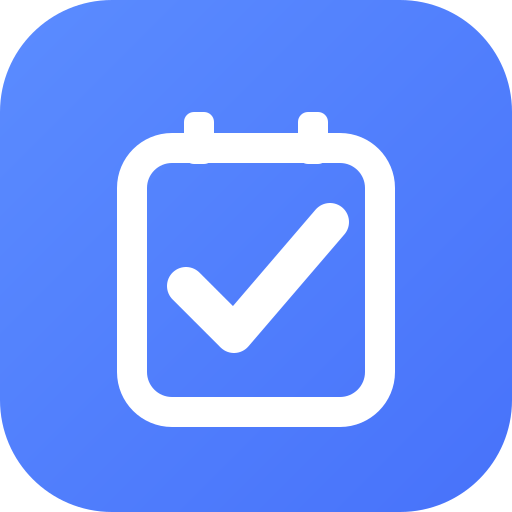
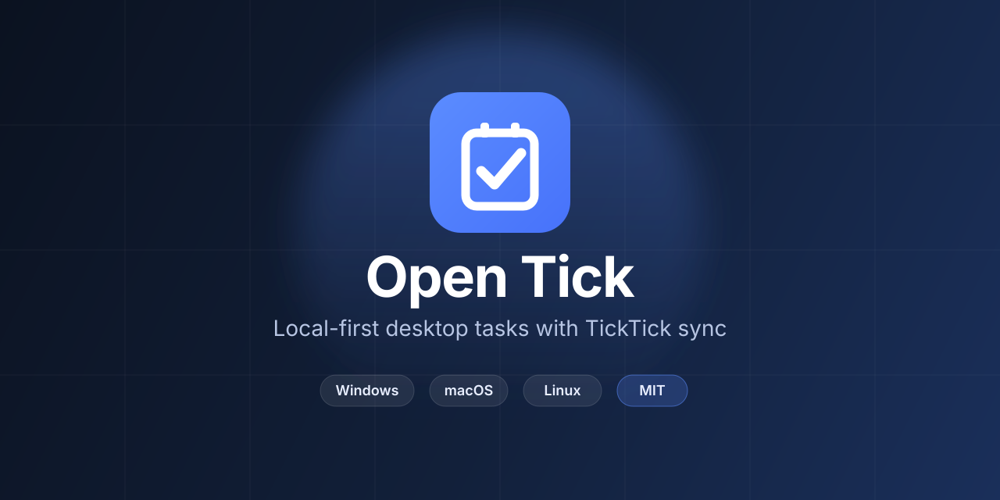

<p align="center">
  
</p>

<h1 align="center">Open Tick</h1>

<p align="center">
  <strong>Local-first desktop task manager</strong> with optional TickTick sync.<br />
  Built for Windows, macOS, and Linux with Electron + React.
</p>

<p align="center">
  <a href="#quick-start"></a>
  <a href="LICENSE"></a>
  <a href="https://dalink.to/artyomnosevich"></a>
</p>

<p align="center">
  
  
  
  
  
</p>

<p align="center">
  
</p>

---

## Why Open Tick?

TickTick-like productivity on your desktop, without giving up offline control:

- **Local-first** — SQLite on disk is the source of truth; the UI stays fast offline
- **TickTick sync** — connect when you want; pull today, outbound push on the roadmap
- **Familiar workflow** — inbox, projects, folders, tags, priorities, subtasks, calendar
- **Native desktop** — system tray, shortcuts, reminders, optional auto-start
- **Yours to run** — open source, no account required to use the local app

## Features

| Area | What you get |
|------|----------------|
| **Lists & tasks** | Inbox, projects, folders, tags, priorities, subtasks, drag reorder |
| **Scheduling** | Due dates, duration tasks, reminders, recurrence |
| **Views** | Today / upcoming smart lists, calendar month & agenda |
| **Editing** | Markdown notes with formatting toolbar and Ctrl/Cmd-click links |
| **Appearance** | Light / dark / system themes, custom colors & fonts |
| **Integrations** | TickTick OAuth, inbound sync, connection status in the UI |

## Quick start

**Prerequisites:** Node.js 20+ and npm 10+

```bash
npm install
npm run dev          # hot-reload Electron app
npm run build        # production build → out/
npm run preview      # run the production build
```

### Package installers

```bash
npm run package:win    # Windows NSIS
npm run package:mac    # macOS DMG (requires macOS)
npm run package:linux  # Linux AppImage + deb (x64)
```

### GitHub Releases (CI)

Push a `release/X.Y.Z` branch to build installers for Windows, macOS, and Linux and publish a GitHub Release tagged `vX.Y.Z`:

```bash
git checkout main
git pull
git checkout -b release/1.0.1
# optional: bump notes / changelog, then:
git push -u github HEAD
```

The [Release](.github/workflows/release.yml) workflow:

1. Runs lint, typecheck, and tests
2. Builds NSIS / DMG / AppImage+deb on GitHub-hosted runners
3. Creates release **Open Tick X.Y.Z** with those artifacts

Prerelease versions work too, e.g. `release/1.1.0-beta.1` → tag `v1.1.0-beta.1` (marked as prerelease).

> macOS artifacts are **unsigned**. Users may need to right-click → Open, or run  
> `xattr -cr "/Applications/Open Tick.app"` after installing.
>
> **Windows:** if the app exits immediately with `Invalid file descriptor to ICU data received`,
> reinstall with the NSIS installer (it grants sandbox ACLs), or run as admin once:
> `icacls "%LOCALAPPDATA%\Programs\Open Tick" /grant *S-1-15-2-2:(OI)(CI)(RX) /T`
> (adjust the path if you chose a custom install directory). Do not run from a network/OneDrive folder.

### Useful scripts

| Script | Description |
|--------|-------------|
| `npm run dev:seed` | Dev app with sample data |
| `npm run test` | Unit tests (Vitest) |
| `npm run lint` / `typecheck` | Quality gates |
| `npm run format` | Prettier |

## TickTick OAuth setup

1. Register an app at [developer.ticktick.com](https://developer.ticktick.com/)
2. Set the redirect URI to `http://127.0.0.1:18463/callback`
3. In the app: **Settings → Account** — enter **Client ID**, **Client Secret**, and region
4. Click **Connect TickTick** — a full pull starts automatically

> Optional for local experiments: `.env` / `TICKTICK_ACCESS_TOKEN` still work in development.

### Native module note (Windows)

`better-sqlite3` needs a native build. Use **Node.js 20 LTS** and [Visual Studio Build Tools](https://visualstudio.microsoft.com/visual-cpp-build-tools/) with the **Desktop development with C++** workload, then:

```bash
npm install
npx electron-rebuild -f -w better-sqlite3
```

If install fails on `better-sqlite3`, use `npm install --ignore-scripts` and rebuild as above.

## Project structure

```
electron/     Main process + preload
src/          React renderer (UI)
shared/       Shared types & IPC channels
docs/         Architecture & implementation docs
resources/    App icons for packaging
```

## Documentation

| Document | Purpose |
|----------|---------|
| [Roadmap](./docs/ROADMAP.md) | Phased plan and acceptance criteria |
| [Architecture](./docs/ARCHITECTURE.md) | Process model & tech stack |
| [TickTick API](./docs/TICKTICK-API.md) | OAuth, endpoints, limits |
| [Data model](./docs/DATA-MODEL.md) | Entities, IDs, sync fields |
| [Local storage](./docs/LOCAL-STORAGE.md) | SQLite schema & locations |
| [Sync strategy](./docs/SYNC-STRATEGY.md) | Offline-first sync & conflicts |
| [UI spec](./docs/UI-SPEC.md) | Screens, shortcuts, theming |
| [Development](./docs/DEVELOPMENT.md) | Setup, testing, packaging |
| [Manual tests](./docs/MANUAL-TESTS.md) | Free vs premium sync cases |

## Buy Me a Coffee

If Open Tick saves you time or sparks ideas, you can support development here:

<p align="center">
  <a href="https://dalink.to/artyomnosevich">
    
  </a>
</p>

**[https://dalink.to/artyomnosevich](https://dalink.to/artyomnosevich)**

Every coffee helps keep the project moving — thank you!

## License

Released under the [MIT License](LICENSE).
