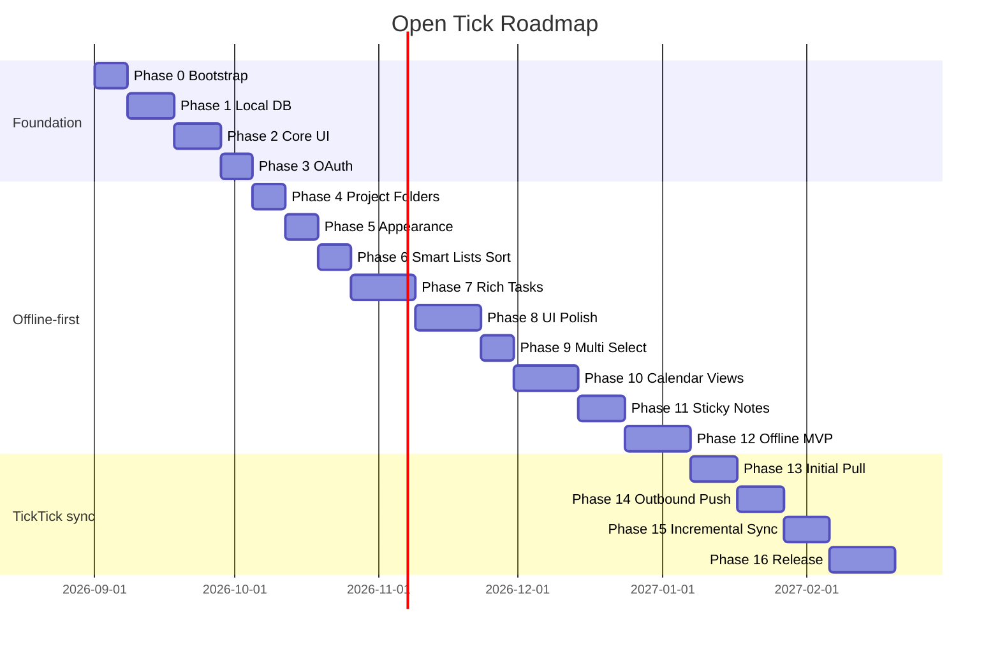

# Development Roadmap

This roadmap breaks Open Tick into **16 phases** across two tracks:

1. **Phases 0–12 — Offline-first** — full local app, usable without network
2. **Phases 13–16 — TickTick sync** — pull first, then push, then incremental/conflicts

Phases 0–13 are complete (offline MVP + initial TickTick pull). Push starts at Phase 14.

**Principles**

- **Local-first**: every read/write hits SQLite first; sync runs in the background once enabled.
- **Offline before network**: ship a complete standalone task manager before pulling or pushing to TickTick.
- **Vertical slices**: ship usable features early (view tasks before calendar polish).
- **API parity where it matters**: focus on projects, folders, tasks, tags, due dates, completion, reminders, recurrence, and calendar — **habits and Focus/Pomodoro are explicitly out of scope** for this project.
- **Feature parity goal**: match TickTick's core task/calendar/note workflow on desktop; defer collaboration, mobile-only features, and premium-only niceties until after MVP.

---

## TickTick Feature Parity Map

Legend: ✅ in scope · 🚫 excluded · ⏳ deferred (v2+)

| Feature area | TickTick capability | Phase | Status |
|--------------|---------------------|-------|--------|
| **Lists & tasks** | Inbox, projects, subtasks, tags, priority | 2 | ✅ |
| **Lists & tasks** | Project folders (group lists in sidebar) | 4 | ✅ |
| **Lists & tasks** | Move task between lists | 2, 14 | ✅ |
| **Lists & tasks** | Duration tasks — data model (`start_date`, `due_date`) | 7 | ✅ |
| **Lists & tasks** | Duration tasks — create & edit UI (calendar, date picker) | 10 | ✅ |
| **Lists & tasks** | Task templates | — | ⏳ |
| **Lists & tasks** | Attachments | — | ⏳ |
| **Lists & tasks** | Comments | — | ⏳ |
| **Sorting** | Sort by order / due date / title / priority | 6 | ✅ |
| **Sorting** | Manual drag reorder within list | 2, 6 | ✅ |
| **Sorting** | Persist sort preference per project | 6 | ✅ |
| **Appearance** | Custom font (family + size) | 5 | ✅ |
| **Appearance** | Theme presets (light / dark / system) | 5 | ✅ |
| **Appearance** | Theme from image (extract palette) | 5 | ✅ |
| **Appearance** | Custom theme colors (manual pickers) | 5 | ✅ |
| **Descriptions** | Markdown task body (headings, lists, bold, links) | 7 | ✅ |
| **Descriptions** | Slash commands, rich toolbar, inline images | 7 | ✅ stretch |
| **Reminders** | Multiple reminders per task (up to 5) | 7 | ✅ |
| **Reminders** | End-time / “when due” reminder | 7 | ✅ |
| **Reminders** | OS notifications (local scheduler) | 12 | ✅ |
| **Reminders** | Constant reminder (repeat until done) | — | ⏳ |
| **Reminders** | Email / location reminders | — | ⏳ (mobile/platform) |
| **Recurring** | Daily / weekly / monthly / yearly repeat | 7 | ✅ |
| **Recurring** | Custom repeat (by due date, completion, specific dates) | 7 | ✅ |
| **Recurring** | Repeat ends on date / after N occurrences | 7 | ✅ |
| **Recurring** | Edit “only this recurrence” vs all future | 7, 10 | ✅ |
| **Recurring** | Calendar: show all repeat cycles | 10 | ✅ |
| **Calendar** | Month view + day agenda | 10 | ✅ |
| **Calendar** | Week view, day view, agenda list | 10 | ✅ |
| **Calendar** | Create duration tasks (time range, multi-day) | 10 | ✅ |
| **Calendar** | Drag task to reschedule | 10 | ⏳ stretch |
| **Calendar** | Year / multi-week / grid view | — | ⏳ |
| **Calendar** | Subscribe external calendars (Google, etc.) | — | ⏳ |
| **Smart lists** | Today, Tomorrow, Next 7 Days, Overdue, Completed | 6 | ✅ |
| **Smart lists** | Custom filters / smart lists | — | ⏳ |
| **Smart lists** | Eisenhower matrix view | — | ⏳ |
| **Views** | Kanban board per project | — | ⏳ |
| **Views** | Timeline view | — | ⏳ |
| **UX** | Task list polish (layout, tags below title, drag & drop) | 8 | ✅ |
| **UX** | Task context menu (date, priority, tags, move, delete) | 8 | ✅ |
| **UX** | Slim detail panel (content-focused, actions in menu) | 8 | ✅ |
| **UX** | Persistent task panel in list view (empty when unselected) | 8 | ✅ |
| **UX** | Resizable / expandable panels (sidebar, list, detail) | 8 | ✅ |
| **UX** | Sidebar context menus (smart lists, folders, projects) | 8 | ✅ |
| **UX** | Open task in full window | 8 | ✅ |
| **UX** | UI animations & visual polish | 8 | ✅ |
| **UX** | Multi-select (Ctrl/Shift) + bulk context menu | 9 | ✅ |
| **UX** | Panel shows one task only (summary when multi-select) | 9 | ✅ |
| **Notes** | Task sticky notes (edit description, pin, move) | 11 | ✅ |
| **Notes** | Standalone sticky notes (no task link) | — | ⏳ |
| **Search** | Quick find / full-text search | 12 | ✅ |
| **Account** | OAuth connect / disconnect (no data sync yet) | 3 | ✅ |
| **Sync** | Initial pull (verify remote → local) | 13 | ✅ |
| **Sync** | Outbound push (local → TickTick) | 14 | ✅ |
| **Sync** | Incremental pull, conflicts | 15 | ✅ |
| **Sync** | Integration panel (status, sync now; pending push in Phase 14) | 13–15 | ✅ |
| **Desktop** | Tray, global shortcut, auto-start, window state | 12 | ✅ |
| **Excluded** | Habit tracker | — | 🚫 |
| **Excluded** | Focus timer / Pomodoro | — | 🚫 |
| **Excluded** | Countdowns (birthday/anniversary widgets) | — | 🚫 |
| **Excluded** | Collaboration / shared lists | — | ⏳ |

---

## Phase 0 — Project Bootstrap (Week 1)

**Goal:** Runnable Electron + React shell on Windows and macOS.

### Tasks

- [x] Initialize monorepo-style layout (`electron-vite` template)
- [x] Configure TypeScript strict mode, ESLint, Prettier
- [x] Set up Tailwind + base layout (sidebar + main content)
- [x] Wire IPC skeleton: `ping` / `getAppVersion`
- [x] Add electron-builder config for Win + Mac (unsigned dev builds)
- [x] CI stub: lint + typecheck on push

### Acceptance criteria

- `npm run dev` opens a window with hot reload
- `npm run build` produces installable artifacts for both platforms
- README dev instructions verified on at least one OS

### Docs to read

- [ARCHITECTURE.md](./ARCHITECTURE.md)
- [DEVELOPMENT.md](./DEVELOPMENT.md)

---

## Phase 1 — Local Data Layer (Week 1–2)

**Goal:** Persist tasks and projects locally without TickTick connection.

### Tasks

- [ ] Integrate `better-sqlite3` in main process only
- [ ] Implement schema v1 + migration runner (see [LOCAL-STORAGE.md](./LOCAL-STORAGE.md))
- [ ] CRUD repositories: `ProjectRepository`, `TaskRepository`, `TagRepository`
- [ ] Expose typed IPC handlers for all CRUD operations
- [ ] Seed data script for development
- [ ] Unit tests for repositories (in-memory SQLite)

### Acceptance criteria

- Create/edit/delete/complete tasks offline with data surviving app restart
- Migrations apply cleanly on first launch and on upgrade
- Renderer never imports Node/SQLite modules directly

---

## Phase 2 — Core UI (Week 2–3)

**Goal:** Usable task manager UI backed by local DB only.

### Tasks

- [ ] Sidebar: Inbox, Today, Next 7 Days, Projects list
- [ ] Task list view with checkboxes, priority indicators, due date chips
- [ ] Task detail panel: title, notes (plain text initially), due date, priority, tags, subtasks
- [ ] Quick-add input (Enter to create in current list)
- [ ] Project CRUD (name, color)
- [ ] Move task between projects (local only)
- [ ] Manual drag reorder within list (`sort_order`)
- [ ] Empty states, loading states, basic error toasts
- [ ] Basic light/dark theme toggle (full appearance settings in Phase 5)

### Acceptance criteria

- Full task workflow works offline: add → edit → complete → delete
- Subtasks render nested under parent
- Drag reorder persists across restart
- Keyboard: `N` new task, `Esc` close panel, `Cmd/Ctrl+K` quick add (optional in this phase)

### Docs to read

- [UI-SPEC.md](./UI-SPEC.md)
- [DATA-MODEL.md](./DATA-MODEL.md)

---

## Phase 3 — TickTick Authentication (Week 3)

**Goal:** Connect a TickTick account via OAuth 2.0. **Account linking only — no data sync in this phase.**

### Tasks

- [x] Register app at [TickTick Developer Portal](https://developer.ticktick.com/)
- [x] Implement OAuth authorization code flow in main process
- [x] Local loopback redirect server (`http://127.0.0.1:<port>/callback`)
- [x] Secure token storage: `safeStorage` (Electron) with encrypted fallback file
- [x] Settings screen: Connect / Disconnect / connection status
- [x] Store `client_id`, `client_secret` via env / config (never commit secrets)
- [x] Show “Sync available after offline features” or disabled sync UI until Phase 13

### Acceptance criteria

- User can authorize and see "Connected as …" in settings
- Token refresh handled if TickTick returns refresh tokens (document actual behavior during impl)
- Disconnect clears stored tokens
- App works fully with no account connected; connecting does not trigger pull/push

### Docs to read

- [TICKTICK-API.md](./TICKTICK-API.md) — OAuth section

---

# Track A — Offline-first (Phases 4–12)

Complete these before any sync implementation. The app must be a fully usable local task manager on its own.

---

## Phase 4 — Project Folders (Week 4)

**Goal:** Organize projects into collapsible folders in the sidebar, matching TickTick's list grouping.

> TickTick allows **one level** of nesting: projects live inside a folder; folders cannot nest inside other folders.

### Schema additions

- [x] `project_folders` table: `id`, `remote_id` (nullable), `name`, `sort_order`, timestamps
- [x] `folder_id` FK on `projects` (nullable — top-level projects have `NULL`)

### Tasks

- [x] `ProjectFolderRepository` + typed IPC handlers (create, rename, delete, reorder)
- [x] Sidebar UI: collapsible folder rows with nested project list
- [x] Create folder (`+ New Folder`), rename, delete (projects inside move to top level)
- [x] Drag project into folder / drag out to top level
- [x] Drag reorder folders and projects within a folder
- [x] Context menus: folder (rename, delete), project (move to folder…)
- [x] Persist folder expand/collapse state locally

### Acceptance criteria

- User can create folders and assign projects with no network
- Folder expand/collapse state persists across restart
- Deleting a folder ungroups its projects (does not delete projects)
- Sidebar layout: smart lists → folders/projects → settings

### Docs to read

- [DATA-MODEL.md](./DATA-MODEL.md) — update with `ProjectFolder` entity

---

## Phase 5 — Appearance & UI Settings (Week 5)

**Goal:** Rich, user-controlled look and feel — fonts and themes beyond the Phase 2 light/dark toggle.

### Settings storage

Extend `settings` table (JSON values) — see [DATA-MODEL.md](./DATA-MODEL.md):

| Key | Description |
|-----|-------------|
| `appearance.font_family` | CSS font stack (preset or custom) |
| `appearance.font_size` | Base size in px (12–20) |
| `appearance.theme_mode` | `light` \| `dark` \| `system` |
| `appearance.theme_source` | `preset` \| `image` \| `custom` |
| `appearance.preset_id` | Built-in palette id |
| `appearance.custom_colors` | `{ bg, sidebar, text, accent, border, … }` |
| `appearance.image_theme_path` | Local path to source image (userData) |
| `appearance.extracted_palette` | Colors derived from image |

### Font settings

- [x] **Appearance** tab in Settings (dedicated section, not buried in General)
- [x] Font family picker: system default + curated list (Inter, Segoe UI, Georgia, JetBrains Mono, etc.)
- [x] Optional custom font: user enters CSS `font-family` string (advanced)
- [x] Font size slider or stepper (scales base `rem` / CSS variable)
- [x] Live preview sample text in settings panel
- [x] Apply globally via `--font-family` and `--font-size-base` on `:root`

### Theme settings

Three theme sources (user picks one):

**1. Presets**

- [x] Built-in palettes: Default, Midnight, Paper, Solarized-style, High contrast (min 4–6 presets)
- [x] Each preset defines full token set: `--bg-primary`, `--bg-sidebar`, `--text-primary`, `--accent`, `--border`, priority colors
- [x] Light / dark / system mode still applies (preset × mode matrix or mode-specific presets)

**2. Theme from image**

- [x] Upload or pick image file (jpg/png/webp); store copy in `userData/themes/`
- [x] Extract palette in renderer or main: dominant + accent colors (e.g. canvas sampling or `node-vibrant` in main)
- [x] Map extracted colors → theme tokens (background from muted color, accent from vibrant, ensure contrast)
- [ ] Optional: use image as subtle sidebar/main background with overlay for readability (stretch)
- [x] Re-generate button if user replaces image

**3. Custom colors**

- [x] Manual color pickers per token: background, sidebar, primary text, secondary text, accent, border
- [x] Contrast warning if text/background ratio fails WCAG AA (non-blocking)
- [x] Reset to preset defaults

### Implementation tasks

- [x] `ThemeProvider` / `useAppearance()` — load settings, inject CSS variables, subscribe to changes
- [x] `AppearanceSettings.tsx` with tabs: Font · Theme
- [x] IPC `settings:get` / `settings:set` for appearance keys (already exists; extend types)
- [x] Persist and apply on app launch before first paint (avoid flash — read sync from main on startup)
- [x] Sticky notes and Integration panel inherit theme tokens

### Acceptance criteria

- Changing font applies across sidebar, task list, detail panel, and settings immediately
- User can switch between preset, image-derived, and custom color themes
- Image upload produces a coherent usable theme without manual tweaking
- Custom color edits persist across restart
- `system` mode follows OS light/dark while respecting chosen palette
- All appearance features work offline with no account

### Docs to read

- [UI-SPEC.md](./UI-SPEC.md) — Appearance settings section

---

## Phase 6 — Smart Lists & Sorting (Week 5–6)

**Goal:** Time-based smart lists and TickTick-style sort options.

### Tasks

- [x] **Today** / **Tomorrow** / **Next 7 Days** / **Overdue** / **Completed** filters (local query layer)
- [x] Overdue styling and default sort (overdue first, then due date)
- [x] Sort picker per list: **order** (manual), **due date**, **title**, **priority**
- [x] Persist sort mode per project / smart list in settings
- [x] Option to show/hide completed tasks
- [ ] Optional: group Today by project or priority

### Acceptance criteria

- Today view shows only tasks due today (respect timezone setting)
- Changing sort reorders list instantly from local DB
- Sort preference survives app restart
- Completed view sorted by `completed_at` DESC

---

## Phase 7 — Rich Tasks: Markdown, Reminders & Recurrence (Week 6–7)

**Goal:** Task detail depth matching TickTick — descriptions, alerts, and repeating rules. **All local; sync mapping deferred to Phase 13.**

### Schema additions

- [x] `task_reminders` table: `task_id`, `trigger_at` or `offset_minutes`, `kind` (`before` | `at_due` | `after`)
- [x] `recurrence_rule` on tasks: RRULE-like JSON (daily/weekly/monthly/yearly/custom)
- [x] `recurrence_parent_id` for exception instances (“only this recurrence” edits)
- [x] `start_date` + duration fields for multi-day / timed range tasks (schema only — create UI in Phase 10)

### Markdown descriptions

- [x] Markdown editor in task detail (WYSIWYG single view with toolbar)
- [x] Support: headings, bold/italic, bullet & numbered lists, links, code blocks
- [ ] Slash `/` menu for headings and lists (stretch)

### Multiple reminders

- [x] Add/remove up to **5 reminders** per task
- [x] Presets: at due time, 5/15/30/60 min before, 1 day before, custom offset
- [x] End-time reminder for duration tasks
- [x] Store reminders in SQLite (notification scheduling in Phase 12)

### Recurring tasks

- [x] Repeat presets: every day, week, month, year
- [x] Custom repeat: by due date, by completion date, specific weekdays/dates
- [x] Repeat ends: never, on date, after N occurrences
- [x] Complete recurring task → spawn next instance per rule
- [x] Edit single occurrence vs all future (detail panel; calendar in Phase 10)

### Acceptance criteria

- Task description renders markdown correctly in detail panel
- User can set 3+ reminders on one task; values persist in DB
- “Every Monday” task generates next instance after completion
- Editing one occurrence does not change future instances
- Everything works with no account connected

> **Note:** Task list layout, context menus, and slim detail panel are refined in **Phase 8** after this phase lands the data model.

---

## Phase 8 — UI Polish (Week 7–8)

**Goal:** Refine task list and detail UX to match TickTick — comfortable layout, smooth interactions, actions via context menu, full-window task view.

### Task list redesign

- [x] **Layout**: two-line rows — title on first line; **tags on second line** below title (not inline right)
- [x] Due date + priority as compact chips on the right; subtask progress under title when present
- [x] Increase row padding and line-height for readability; tune hover/selected states
- [x] Softer visual hierarchy: muted secondary text, clear focus ring for keyboard nav
- [x] List density option in settings: Comfortable (default) / Compact

### Drag & drop polish

- [x] Drag handle on hover (or whole-row drag with threshold to avoid mis-clicks)
- [x] Live drop indicator line between rows; auto-scroll when dragging near edges
- [x] Smooth drag ghost following cursor; animate list reflow on drop
- [ ] Drag between projects in sidebar (stretch) — move task to list on drop

### Context menu (right-click)

Move **actions out of the expanded detail panel** into a TickTick-style context menu:

- [x] **Date & reminder** — submenu with presets + custom picker
- [x] **Priority** — none / low / medium / high
- [x] **Tags** — quick tag toggle + manage tags dialog
- [x] **Move to list** — project/folder picker
- [x] **Add subtask**
- [x] **Duplicate task**
- [x] **Copy link** (local task id / deep link for full window)
- [x] **Open in new window**
- [x] **Delete** — with confirm
- [x] **Mark complete / incomplete**

Context menu also available via `⋮` button on row hover (keyboard accessible).

### Persistent right task panel

When the **task list view** is active, the right task panel is **always visible** — not toggled on/off by selection.

- [x] Three-pane list layout: **sidebar | task list | task panel** (fixed structure)
- [x] **No task selected** → panel shows empty state: illustration + “Select a task to view details” + optional quick-add CTA
- [x] **Task selected** → panel shows slim `TaskDetail` for that task
- [x] Clicking a row updates panel content; clicking away / deselect clears to empty state
- [x] Creating a new task auto-selects it and fills the panel
- [x] Panel does **not** appear in non-list views (Settings replaces main content; Calendar may use same three-pane when a day list is shown — stretch)

### Resizable & expandable panels

All major layout regions support drag-to-resize and collapse:

- [x] **Sidebar** ↔ **task list** divider: drag to resize sidebar width (180–360px); double-click resets default
- [x] **Task list** ↔ **task panel** divider: drag to resize panel width (280–560px); double-click resets default
- [x] **Sidebar collapse**: toggle to icons-only mode (64px); expand restores previous width
- [ ] **Task panel collapse** (stretch): chevron to hide panel entirely in narrow windows; list view becomes two-pane
- [x] Persist `layout.sidebar_width`, `layout.detail_width`, `layout.sidebar_collapsed` in settings
- [x] Respect min window width: panels enforce minimums; list column never shrinks below ~280px

### Sidebar context menus (projects, folders, smart lists)

Extend Phase 4 folder/project menus into full TickTick-style right-click on **all** sidebar items:

**Project (list)**

- [x] Add task
- [x] Rename
- [ ] Change color
- [x] Move to folder → submenu of folders + “None (top level)”
- [ ] Duplicate list (stretch)
- [x] Delete list (confirm; tasks deleted or moved per dialog)

**Folder**

- [x] Add list inside folder
- [x] Rename folder
- [x] Delete folder (ungroup lists, confirm)
- [x] Expand / Collapse folder

**Smart list** (Inbox, Today, Tomorrow, Next 7 Days, Completed)

- [x] Add task (with smart defaults: Today → due today, Inbox → inbox project, etc.)
- [ ] Completed only: **Clear all completed** (stretch)

- [x] Right-click and `⋮` on hover for every sidebar row (smart list, folder header, project)
- [ ] Keyboard: `Menu` key or `Shift+F10` opens context menu for focused sidebar item

### Slim detail panel

Refactor `TaskDetail` to match TickTick — **content-focused**, not action-heavy:

- [x] **Keep in panel**: title, markdown description, subtasks, reminder/recurrence summary (read-only chips linking to context menu or inline expand)
- [x] **Remove from panel** (moved to context menu): priority picker, tag editor, project mover, delete button as primary controls
- [x] Optional one-line metadata strip: due date · priority dot · project name (click opens context menu section)
- [x] Panel width ~400px; more whitespace around description editor

### Full-window task view

- [x] **Open in new window** from context menu or `Cmd/Ctrl+Shift+O` when task selected
- [x] New `BrowserWindow` (or route) showing single task — same slim detail layout, larger editor area
- [x] IPC: `task:openWindow(taskId)`, `task:closeWindow(taskId)`; window title = task title
- [x] Edits sync to main window via `sync:changed` / shared DB (instant local)
- [ ] Multiple task windows allowed; restore open task windows on restart (stretch)

### Settings & layout rules

- [x] **Settings** and **Integration panel** navigate away from or overlay the list layout — they do not share the three-pane list view
- [x] Opening Settings replaces main content (task list + panel hidden until user returns to a list)
- [ ] Integration panel: slide-over from footer; does not destroy list layout underneath (stretch: or replace main like Settings)
- [x] Returning to a list restores three-pane layout with last selection (or empty panel if none)

### Animations & UI optimization

- [x] Panel resize: no animation during drag; subtle snap on double-click reset
- [x] Empty panel → task selected: cross-fade content (150ms)
- [x] Task complete: checkbox fill + row fade/strike animation
- [ ] List insert/remove: height collapse animation
- [ ] Page transitions: list ↔ calendar cross-fade (stretch)
- [x] Respect `prefers-reduced-motion` — disable or shorten all animations
- [x] Audit render performance: memoize `TaskRow`, avoid layout thrash during drag

### Acceptance criteria

- Tags always render below task title, never cramped on the same line
- Right-click any task shows full action menu; no need to open panel for date/priority/tags/move/delete
- In list view, right task panel is always visible; empty state when nothing selected
- Sidebar and task panel widths persist across restart; drag dividers work smoothly
- Right-click on any smart list, folder, or project shows appropriate context menu
- Detail panel feels like TickTick: write notes and manage subtasks, not a form of buttons
- Settings open → list layout hidden; returning to a list restores three-pane layout
- User can open a task in a dedicated window; edits appear in main app immediately
- Drag reorder feels smooth with visible drop target
- Animations enhance UX without slowing interaction; reduced-motion honored

### Docs to read

- [UI-SPEC.md](./UI-SPEC.md) — Task list, context menu, detail panel sections

---

## Phase 9 — Multi-Select & Bulk Operations (Week 8)

**Goal:** Select multiple tasks and apply batch actions via context menu, while the right panel always shows at most one task.

### Multi-select interaction

- [x] **Ctrl+click** (Cmd on macOS): toggle task in selection set (add/remove)
- [x] **Shift+click**: range select from last focused task to clicked task (in current list order)
- [x] **Click** (no modifier): single select — clears multi-selection, selects one task
- [x] **Click empty list area** or **Esc**: clear all selection
- [x] Selected rows: distinct background + left accent; show selection count in list header (e.g. `3 selected`)
- [x] Checkbox on row completes the task (does not clear multi-select)
- [ ] `Ctrl/Cmd+A`: select all visible tasks in current list (stretch)

### Right panel behavior (single task only)

- [x] **0 tasks selected** → empty panel (“Select a task to view details”)
- [x] **1 task selected** → show that task’s detail in panel (normal behavior)
- [x] **2+ tasks selected** → panel shows **multi-select summary** (not a stacked list of tasks):
  - Message: `3 tasks selected`
  - Hint: “Right-click selection for bulk actions”
  - Optional: list selected titles as read-only truncated list (max 5 + “and N more”)
- [x] **Never** render multiple full task editors side-by-side or in tabs in the right panel
- [x] If user completes bulk action, selection clears or stays per action (delete → clear; move → clear)

### Bulk context menu

Right-click when **2+ tasks** selected (or right-click a selected row while multi-select active):

| Action | Behavior |
|--------|----------|
| **Date & reminder** | Set same due date / duration on all selected |
| **Priority** | Set priority on all selected |
| **Tags** | Add tag to all · Remove tag from all · Replace tags (stretch) |
| **Move to list** | Move all to chosen project |
| **Mark complete** | Complete all pending |
| **Mark incomplete** | Reopen all completed |
| **Delete** | Confirm: “Delete N tasks?” → bulk delete |

- [x] Right-click with multi-select shows bulk menu; single-task menu when exactly one selected
- [x] Bulk operations use `TaskRepository` batch methods or transaction in main process
- [x] IPC: `task:bulkUpdate`, `task:bulkDelete`, `task:bulkComplete` (or single handler with payload)
- [x] Toast summary (“Moved 3 tasks…”) after bulk actions
- [x] Disable actions that don’t apply (e.g. “Mark incomplete” when all already pending)

### Implementation tasks

- [x] `taskSelectionStore`: `selectedIds`, `anchorId`, range select on Shift+click
- [x] `BulkTaskContextMenu.tsx` vs `TaskContextMenu.tsx` based on selection count
- [x] `TaskPanelMultiSelect.tsx` for 2+ selected empty/summary state
- [ ] List header bulk bar (stretch): quick Complete / Delete / Move when selection active

### Acceptance criteria

- Ctrl+click and Shift+click select multiple tasks as expected
- Right-click on multi-selection shows bulk actions only; all apply to every selected task
- With 2+ tasks selected, right panel never shows more than one task detail editor
- With exactly 1 task selected, panel shows that task’s full detail
- Bulk delete/move/complete/priority/date work on 3+ tasks in one action
- Selection survives scroll; clears on list change (optional: preserve if same list)

### Docs to read

- [UI-SPEC.md](./UI-SPEC.md) — Multi-select section

---

## Phase 10 — Calendar Views (Week 9–10)

**Goal:** Full calendar experience matching TickTick's scheduling workflow.

### Tasks

- [x] View switcher: **List** ↔ **Calendar** in main content area
- [x] **Month** view: task dots/counts per day, click date → day agenda
- [x] **Week** view: time grid for timed tasks, all-day row for all-day tasks
- [x] **Day** view: hourly agenda for selected date
- [x] **Agenda** view: scrollable upcoming tasks across days
- [x] Respect `week_starts_on` and user timezone in all views
- [x] Recurring tasks: optional “Show all iterations” toggle in calendar (Settings → Calendar)
- [ ] Drag task to change due date (stretch)
- [x] Duration tasks: render spanning `start_date` → `due_date` across days/hours

### Duration tasks — create & edit

TickTick **duration** tasks have a **start** and **end** (not just a single due datetime). Phase 7 stores the fields; Phase 10 ships the full create/edit UX.

**Date & time picker (Duration mode)**

- [x] **Date & reminder** context menu / picker: toggle **Time** vs **Duration**
- [x] **Duration mode**: start date + start time, end date + end time (`start_date` + `due_date`)
- [x] **All-day duration**: toggle all-day → allow span across multiple calendar days (e.g. Mon–Wed)
- [x] **Timed duration**: same-day or cross-midnight range on week/day grid
- [x] Clear duration → revert to single due date (point-in-time task)
- [x] Validation: end must be ≥ start; show inline error if invalid

**Create from calendar**

- [x] **Week / day view**: click-drag on time grid to create task with selected time range
- [ ] **Month view**: click-drag across days in all-day row to create multi-day duration task (stretch)
- [x] New task opens in task panel with title focus; range pre-filled from drag
- [ ] Click empty slot (no drag) → create 1-hour default block at clicked time (stretch)

**Edit duration on calendar**

- [ ] Drag task block to move entire range (preserves duration length)
- [ ] Drag top/bottom edge to change start or end time (stretch)
- [ ] Resize across days in month all-day row (stretch)

**List & panel display**

- [x] Due chip shows range: `Aug 28 10:00 – 12:00` or `Aug 28 – Aug 30` for multi-day all-day
- [x] Task panel metadata strip: start → end with Duration label
- [x] Smart lists (Today, Week) include tasks whose **range overlaps** the window, not only `due_date` on that day

### Acceptance criteria

- [x] Calendar dots/counts match task due dates and duration spans
- [x] Week/day views place timed tasks at correct start hour and render block height by duration
- [x] User can create a duration task via picker (start + end) from context menu or task panel
- [x] User can create a timed task by dragging on week/day calendar grid
- [x] Multi-day all-day duration task appears on every day in range in month view
- [ ] Recurring instances appear on correct dates when toggle enabled
- [x] All views read from local DB only; no network required

### Docs to read

- [UI-SPEC.md](./UI-SPEC.md) — Calendar section

---

## Phase 11 — Sticky Notes (Week 10–11)

**Goal:** Desktop sticky notes matching TickTick — pin a task to the desktop, edit its description in place, keep it on top, and move it anywhere on screen.

> In TickTick, sticky notes are **task-centric**: you pin a task (not a generic blank note). The sticky shows the task and lets you work on it without opening the main window.

### Data model

- [x] `sticky_notes` table (or derive from open windows state):
  - `id`, `task_id` (required FK → tasks), `window_x`, `window_y`, `width`, `height`
  - `is_pinned` (always-on-top), `is_collapsed` (single-line mode), `color` (optional accent)
  - `created_at`, `updated_at`
- [x] Sticky **content** is the task’s `content` field (markdown description) — no duplicate body text
- [x] Title read from `task.title`; edits to title in sticky update the task row

### Create & open

- [x] **Open as sticky note** from task context menu or task panel `⋮` menu
- [x] One sticky per task per screen (re-open focuses existing window if already open)
- [x] New sticky spawns near cursor or last sticky position offset
- [x] Closing sticky window does not delete the task — only closes the desktop pin

### Edit task description (core)

- [x] Sticky body is the **same markdown editor** as task detail (Phase 7) — WYSIWYG or preview toggle
- [x] Edits auto-save to `tasks.content` (debounced 500ms); main app task panel updates via `sync:changed`
- [x] Edits made in main window reflect in open sticky in real time
- [x] Task title editable in sticky header (single line)
- [ ] Checkbox in sticky header to mark task complete (optional stretch)

### Pin (always on top)

- [x] **Pin** button in sticky title bar — toggles `alwaysOnTop` on the `BrowserWindow`
- [x] Shortcut **`F12`** toggles pin while sticky is focused (match TickTick)
- [ ] Settings → Functions → Sticky Note → **Pin by default** for new stickies (stretch)
- [x] Visual state: pinned = filled pin icon; unpinned = outline; unpinned stickies sit behind other apps

### Move & resize

- [x] **Drag title bar** to move sticky anywhere on screen (including across monitors)
- [x] Persist `window_x`, `window_y` on drag end
- [x] **Resize** from bottom-right corner (min ~240×180, max ~600×800)
- [x] Persist `width`, `height` on resize end
- [ ] Double-click title bar → **collapse to single line** (TickTick); shows title only; drag still works (stretch)
- [x] Restored position/size after app restart for all open stickies

### Window chrome

- [x] Frameless floating window with custom title bar: task title, pin, close
- [x] Close button dismisses sticky only (task remains)
- [x] Inherits theme tokens from main app (Phase 5)
- [x] Multiple stickies allowed simultaneously

### Implementation tasks

- [x] `electron/main/windows/stickyNoteWindow.ts` — manage sticky `BrowserWindow` instances per `task_id`
- [x] IPC: `sticky:open`, `sticky:close`, `sticky:list`, `sticky:updateBounds`, `sticky:setPinned`
- [x] `StickyNoteWindow.tsx` route — title bar + markdown editor bound to task
- [x] Subscribe to `sync:changed` for `task_id` to refresh title/content when edited elsewhere

### Acceptance criteria

- User can pin a task as sticky from context menu
- Sticky shows task title + editable markdown **description**; changes persist to the task
- **Pin** keeps sticky above all other windows (including browser); unpin sends it behind
- User can **drag** sticky to any screen position; position survives restart
- User can resize sticky; size survives restart
- Editing description in sticky updates the same task in the main app list/panel
- Fully offline; no TickTick sync required in this phase

### Docs to read

- [UI-SPEC.md](./UI-SPEC.md) — Sticky notes section
- [TickTick Help — Desktop Sticky Notes](https://help.ticktick.com/articles/7055780431722971136)

---

## Phase 12 — Desktop Polish & Offline Hardening (Week 11–12)

**Goal:** Native desktop feel + search and performance. **Offline MVP complete at end of this phase.**

### Desktop polish

- [x] System tray: show/hide, quick add, new sticky note, quit
- [x] Native notifications for task reminders (local scheduler in main process)
- [x] Global shortcut: quick capture window
- [x] Global shortcut: new sticky note (stretch)
- [x] Auto-start on login (opt-in, platform-specific)
- [x] Window state persistence (size, position, maximized)
- [ ] macOS: menu bar integration; Windows: taskbar jump list (stretch)

### Search & performance

- [x] Full-text search (SQLite FTS or FlexSearch) across title + content
- [x] Command palette (`Cmd/Ctrl+K`) wired to search + actions
- [x] Lazy-load / virtualize task lists >500 items
- [x] Export/import local DB backup

### Acceptance criteria

- Tray icon works when main window is closed (if "minimize to tray" enabled)
- Each configured reminder fires OS notification at correct time
- Quick capture creates task in Inbox without focusing main window
- Search finds tasks by title and markdown body within 100ms locally
- Backup/restore works without network
- **Definition of offline MVP:** daily task management, calendar, reminders, recurrence, folders, sticky notes — all without connecting to TickTick

---

# Track B — TickTick sync (Phases 13–16)

Start only after Phase 12 acceptance criteria pass. OAuth from Phase 3 provides tokens; these phases add data flow.

**Order matters:** prove **pull** is correct before enabling **push**. Local edits stay local-only until Phase 14.

---

## Phase 13 — Initial Pull (Week 12–13)

**Goal:** Download TickTick data into SQLite and verify mapping — folders, projects, tasks, reminders, recurrence — **without** writing anything back to TickTick.

### Tasks

- [x] `TickTickApiClient` in main process (fetch wrapper, auth header, retries) — **GET endpoints only** for this phase
- [x] Map API DTOs → local entities (see [DATA-MODEL.md](./DATA-MODEL.md)); set `remote_id`, `sync_status = synced`
- [x] **Initial pull**: folders → projects → project data (tasks) → inbox
- [x] Map project `groupId` ↔ local `folder_id` on pull
- [x] Map reminders, recurrence, markdown `content`, tags, priority, dates
- [x] Upsert / merge rules for pull-only (remote wins when local is `synced`; do not overwrite dirty local rows yet — treat all pre-pull local data carefully)
- [x] **Integration panel** (pull-focused — see below)
- [x] Compact sync indicator in sidebar footer (opens panel on click)
- [x] Manual **Pull now** via `sync:now` (pull only until Phase 14)

### Integration panel (Phase 13 scope)

Dedicated panel to inspect pull status — openable without leaving the main app.

**Open from:** sidebar footer sync chip, `Cmd/Ctrl+Shift+S`, Settings → Integration, tray menu (stretch).

**Display (live via `sync:status-changed` + `sync:getStatus` on open):**

| Field | Description |
|-------|-------------|
| Connection | Connected / Not connected / Token expired |
| Account | Email or display name when connected |
| Sync state | Idle · Pulling · Error |
| Last pulled | Relative + absolute timestamp |
| Last pull result | Success · Partial · Failed |
| Last error | Message + timestamp (if any) |
| Current operation | e.g. "Pulling projects (3/12)" when syncing |
| Counts (stretch) | Folders / projects / tasks last pulled |

**Defer to Phase 14:** Pending push breakdown, push progress, "N changes to push" footer state.

**Actions:**

- [x] **Pull now** — trigger manual full pull
- [x] **Reconnect** — when token expired (links to OAuth flow)
- [x] **View sync log** — expand or link to recent pull entries (full log in Phase 15)
- [x] **Copy error details** — for debugging (stretch)

**Tasks:**

- [x] `SyncStatus` read model in main process (`SyncState` + pull stats; pending push = stub/`0` until Phase 14)
- [x] IPC: `sync:getStatus`, `sync:now` (pull-only); events: `sync:status-changed`, `sync:progress`
- [x] `IntegrationPanel.tsx` — slide-over from sidebar footer
- [x] Disable sync actions when offline or not connected; show clear empty states

### API mapping (folders)

| Local | Remote |
|-------|--------|
| `project_folders.remote_id` | folder `id` |
| `project_folders.name` | `name` |
| `project_folders.sort_order` | `sortOrder` |
| `projects.folder_id` | `groupId` |

### Acceptance criteria

- Fresh connect + pull downloads folders, projects, and tasks into SQLite
- Folder structure from TickTick web/app appears correctly in sidebar
- Task titles, descriptions, due dates, priorities, tags, reminders, and recurrence match TickTick for spot-checked projects
- **No** create/update/delete is sent to TickTick API in this phase
- Local-only edits remain local; next pull does not silently destroy them without a documented rule (prefer skip dirty rows or clear local test data before first pull)
- App remains usable while pull runs in background
- Integration panel shows last pull time and live progress; user can trigger "Pull now"

### Docs to read

- [SYNC-STRATEGY.md](./SYNC-STRATEGY.md)
- [TICKTICK-API.md](./TICKTICK-API.md)

---

## Phase 14 — Outbound Push (Week 13–14)

**Goal:** Push local creates/updates/deletes to TickTick after pull mapping is proven correct.

### Tasks

- [ ] **Outbound queue**: track pending creates/updates/deletes with `sync_status`
- [ ] Push worker: process queue on interval + on connectivity restore
- [ ] Map local entities → API DTOs (`localTaskToRemote`, etc.)
- [ ] Folder / project CRUD push (`POST/PUT/DELETE` project + project group)
- [ ] Task create / update / complete / delete push
- [ ] Move task between projects (`POST /task/move`)
- [ ] Reminders and recurrence round-trip on push
- [ ] Integration panel: **pending push** counts + breakdown; footer "N to push"
- [ ] **Sync now** = pull then drain push queue (or push-only when already pulled)
- [ ] Soft-delete until remote delete confirms

### Acceptance criteria

- Creating a folder, project, or task locally appears in TickTick after sync
- Completing or deleting a task locally syncs remotely
- Reminders and recurrence push without data loss
- Integration panel pending counts rise on local edit and clear after successful push
- Failed push items stay queued and retry; no silent data loss

---

## Phase 15 — Incremental Sync & Conflicts (Week 14–15)

**Goal:** Efficient ongoing sync and sane conflict handling.

### Tasks

- [ ] Track `remote_updated_at` / `etag` per entity where API allows
- [ ] Periodic pull (e.g. every 2–5 min when online + focused)
- [ ] Conflict policy: **last-write-wins by `updated_at`**, log conflicts for review
- [ ] Handle inbox project ID discovery (special `inbox*` id — see API docs)
- [ ] Deletion tombstones: sync deletes both ways (tasks, projects, folders)
- [ ] Exponential backoff on 429/5xx
- [ ] Sync log in Integration panel + Settings (last 100 entries)
- [ ] Integration panel: show conflicts count, auto-sync interval, next scheduled sync
- [ ] Integration panel: expandable sync history with per-run stats (pushed/pulled/failed)

### Acceptance criteria

- Edits made in official TickTick app appear locally within sync interval
- Folder renames and project moves from remote sync correctly
- Simultaneous edits resolve predictably (document behavior in settings)
- No duplicate tasks after reconnect
- Integration panel reflects conflict count and lists recent conflict entries

---

## Phase 16 — Release Hardening (Week 15+)

**Goal:** Stable builds for personal use or distribution.

### Tasks

- [ ] E2E smoke tests (Playwright): offline workflows + connect → pull → push → edit both ways
- [ ] Error reporting hook (optional: Sentry)
- [ ] Auto-update channel (electron-updater) — optional for pet project
- [ ] Code signing notes for Mac (notarization) and Windows
- [ ] Clean install → offline use → connect → pull → push → 7-day soak test

### Acceptance criteria

- Offline MVP and sync both pass E2E suite
- No data loss over 7-day daily use with sync enabled

---

## Explicitly Out of Scope

These TickTick features will **not** be implemented in this project:

| Feature | Reason |
|---------|--------|
| **Habit tracker** | User request — out of scope |
| **Focus timer / Pomodoro** | User request — out of scope |
| **Countdowns** | Closely tied to habits/premium widgets; defer indefinitely |

---

## Deferred to v2+ (in scope eventually, not MVP)

| Feature | Notes |
|---------|-------|
| Kanban board view | `viewMode: kanban` exists on projects; significant UI effort |
| Timeline view | `viewMode: timeline` on projects |
| Custom smart lists / filters | “High priority this week” style saved filters |
| Eisenhower matrix | Priority × urgency grid view |
| Year / multi-week calendar | Lower priority than month/week/day |
| Calendar subscribe (Google, iCal) | Integration project |
| Task templates | Save workflow as reusable template |
| Attachments | File upload + sync |
| Comments | API exists; add with collaboration phase |
| Sticky notes sync | Research TickTick API; likely local-only for v1 |
| Constant / email / location reminders | Platform or premium parity |
| Collaboration / shared lists | API support unclear; research first |
| Mobile companion | Separate project |
| Multiple accounts | Single account per install for v1 |
| Batch edit | Covered by Phase 9 multi-select; advanced tag replace deferred |

---

## Milestone Summary

---

## Definition of Done (global)

Every phase PR / change set should:

1. Typecheck and lint clean
2. Update relevant doc if behavior diverges from spec
3. Not break offline mode (Phases 4–12 must work with no account)
4. Keep secrets out of git
