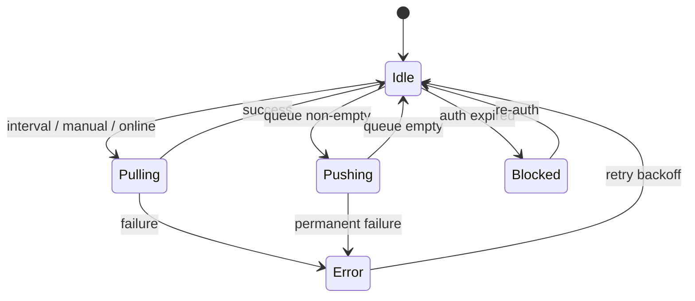

# Sync strategy

Local SQLite is the source of truth for the UI. TickTick catches up in the background.

**Where we are:** pull and push both work (phases 13–14). Incremental + conflicts next (15).

---

## Modes

| Mode | When | Scope |
|------|------|--------|
| Full pull | First connect / Pull now | All projects + inbox |
| Outbound push | After local edits (when push is enabled) | Pending queue |
| Incremental pull | Timer / focus (phase 15) | Re-fetch project data |
| Manual | Sync now | Pull + drain push queue |

Only one sync op at a time (`sync_state.is_syncing`).



---

## Full pull

```
1. is_syncing = true
2. GET /project → upsert projects
3. GET /project/inbox/data → inbox tasks + inbox_remote_id
4. For each project with remote_id:
     GET /project/{id}/data → tasks + tags
5. last_full_sync_at = now; is_syncing = false
6. Emit sync:changed (and sync:progress along the way)
```

---

## Merging one remote task

```
if no local row → insert
if local.sync_status != synced → leave local alone (dirty wins)
if local.deleted_at set → skip (outbound delete owns it)
if remote is newer than local.remote_updated_at → overwrite, mark synced
```

TickTick doesn’t always send a reliable `updatedAt`. If a field is missing, compare what we have or accept remote when local is clean — note what real responses look like in [TICKTICK-API.md](./TICKTICK-API.md).

---

## Push

Drain the queue every few seconds (and after pull / Sync now). Push stays behind the Account setting until you’re ready.

```
for each due queue item (attempts < 5):
  create  → POST /task → set remote_id, synced
  update  → POST /task/{remote_id}
  complete → POST .../complete
  delete  → DELETE ... → hard-delete local on success
on failure: bump attempts, backoff schedule; auth errors pause sync
```

Order: projects before tasks; parents before subtasks.

### Enqueue on local write

| Action | sync_status | Queue op |
|--------|-------------|----------|
| Create | pending_create | create |
| Edit | pending_update | update (one row per entity) |
| Complete | pending_update | complete |
| Delete | pending_delete + deleted_at | delete |

Before inserting an update, drop older queue rows for the same entity (except an in-flight create).

---

## Conflicts

**Dirty local wins until pushed; otherwise remote wins.**

| Local | Remote changed | Result |
|-------|----------------|--------|
| synced | yes | Apply remote |
| pending_* | yes | Keep local, push later |
| synced | deleted remotely | Delete locally |
| pending_update | deleted remotely | Prefer remote delete, log it |

Rare messes go in Settings / Integration sync log (phase 15).

---

## Offline

If `net.isOnline()` is false or fetches fail: pause the pull timer, keep accepting local edits, queue grows. UI can say changes will sync when we’re back. On online: pull, then drain push.

---

## Incremental (phase 15)

No documented delta API. Practical approach: re-GET `/project`, then each `/project/{id}/data`. Skip work if we ever get etags/hashes. `POST /task/filter` with `modifiedSince` is a maybe if it actually works.

Default interval ~3 minutes when authenticated, online, and the window is focused (or tray mode is on). Pause on auth block, overlapping sync, or user turning background sync off.

---

## Idempotency & errors

- Don’t POST create twice — set `remote_id` before removing the queue row; do it in one transaction.
- 401 → refresh once, else `auth:expired` and pause.
- 404 on update → remote gone; drop local (don’t resurrect).
- 429 → wait (~60s). 5xx → exponential backoff, cap attempts.
- Bad row → log, skip, show in sync log.

---

## Events & status

| Event | Payload |
|-------|---------|
| `sync:status-changed` | `SyncStatusDto` |
| `sync:progress` | `{ phase, current, total, … }` |
| `sync:changed` | `{ entityType, entityId?, reason }` |
| `auth:expired` | `{ message }` |

```typescript
interface SyncStatusDto {
  isConnected: boolean;
  accountLabel: string | null;
  isOnline: boolean;
  isSyncing: boolean;
  lastSyncAt: string | null;
  lastSyncResult: 'success' | 'partial' | 'failed' | null;
  lastError: string | null;
  lastErrorAt: string | null;
  pendingPush: { total: number; tasks: number; projects: number; folders: number };
  conflicts: number;
  currentOperation: string | null;
  autoSyncIntervalMinutes: number;
  nextSyncAt: string | null;
}
```

`sync:getStatus` returns the same shape when the panel opens. Renderer invalidates queries on `sync:changed`.

Footer chip: condensed state; click opens the Integration panel. `Cmd/Ctrl+Shift+S` opens + starts pull/sync.

---

## Testing

Mock TickTick with fixtures under `tests/fixtures/ticktick/`. Cover: create offline → online → appears; remote add → pull; dirty local vs remote edit follows the policy above. Log lines like `[SYNC] pull started` / `push create` / `error 401` via electron-log are enough for now; a user-visible log table can wait for phase 15.
