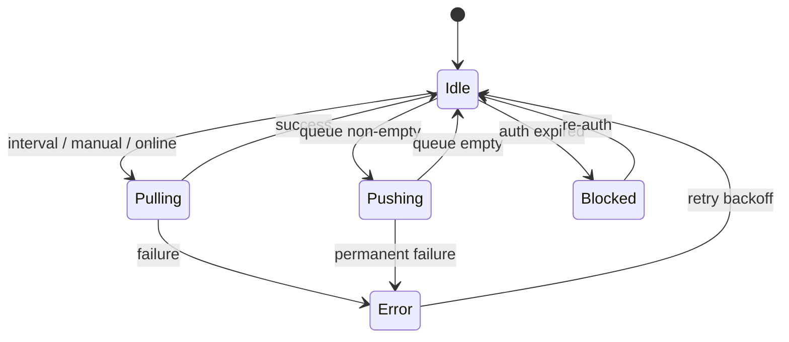

# Sync Strategy

Offline-first synchronization between local SQLite and TickTick Open API.

**Phased rollout**

1. **Phase 13 — Pull only** — prove remote → local mapping
2. **Phase 14 — Outbound push** — local → TickTick
3. **Phase 15 — Incremental + conflicts**
4. **Phase 16 — Release hardening**

---

## Goals

1. UI reads/writes **only** local DB (instant, offline-capable)
2. Changes propagate to TickTick when online
3. Remote changes pulled periodically
4. Failures retried without data loss
5. Predictable conflict behavior

---

## Sync modes

| Mode | Trigger | Scope | Phase |
|------|---------|-------|-------|
| **Initial full pull** | First OAuth connect / Pull now | All projects + inbox + tasks | 13 |
| **Incremental pull** | Timer, app focus, manual | All project data endpoints | 15 |
| **Outbound push** | After local mutation + queue drain | Pending queue items | 14 |
| **Manual sync** | User clicks "Sync now" | Pull only (13); pull + push (14+) | 13–14 |

---

## State machine



Only one sync operation runs at a time (`sync_state.is_syncing` lock).

---

## Initial full sync algorithm

```
1. SET sync_state.is_syncing = true
2. GET /project → upsert all projects (except inbox)
3. GET /project/inbox/data → upsert inbox tasks; discover inbox_remote_id
4. FOR each project P with remote_id:
     GET /project/{P.remote_id}/data
     upsert tasks + tags
5. SET last_full_sync_at = now()
6. SET is_syncing = false
7. EMIT sync:changed to renderer
```

**Progress events:** emit `sync:progress` with `{ phase, current, total }` for UI bar.

---

## Inbound merge (single task)

```
function mergeRemoteTask(remote, local?):
  if local is null:
    INSERT new task from remote
    return

  if local.sync_status != 'synced':
    // local has unpushed edits — local wins
    return

  if local.deleted_at != null:
    // local deleted — push delete wins; skip merge
    return

  remoteUpdated = parse(remote.updatedAt or dueDate fallback)
  if remoteUpdated > local.remote_updated_at:
    UPDATE local fields from remote
    SET sync_status = 'synced'
```

TickTick may not expose `updatedAt` on all DTOs — during implementation, note actual fields from API responses and adjust. If absent, use full field comparison or always accept remote on pull when local is `synced`.

---

## Outbound push algorithm (Phase 14)

Queue processor runs every 5 seconds (configurable). **Do not implement until Phase 13 pull is verified.**

```
WHILE queue item Q where scheduled_at <= now AND attempts < 5:
  TRY:
    CASE Q.operation:
      'create' → POST /task → set remote_id, sync_status=synced
      'update' → POST /task/{remote_id}
      'complete' → POST /project/{pid}/task/{id}/complete
      'delete' → DELETE /project/{pid}/task/{id} → hard delete local
    DELETE queue item Q
  CATCH error:
    INCREMENT attempts
    SET last_error, scheduled_at = now + backoff(attempts)
    IF auth error → STOP, set auth blocked
```

**Ordering:** process projects before tasks; parent tasks before subtasks (topological sort by `parent_id`).

---

## Enqueue rules (on local mutation) — Phase 14

| User action | DB change | Queue operation |
|-------------|-----------|-----------------|
| Create task | `sync_status=pending_create` | `create` |
| Edit task | `pending_update` | `update` (dedupe: one update per entity) |
| Complete | `pending_update` or dedicated | `complete` |
| Delete | `pending_delete`, `deleted_at=now` | `delete` |
| Create project | `pending_create` | `create` via POST /project |

**Deduping:** before insert, delete existing queue row for same `(entity_type, entity_id)` except `create`.

---

## Conflict resolution policy

**Default: local-wins when dirty, otherwise remote-wins**

| Local sync_status | Remote changed | Result |
|-------------------|----------------|--------|
| `synced` | yes | Apply remote |
| `pending_*` | yes | Keep local, push when ready |
| `synced` | deleted remotely | Mark deleted locally |
| `pending_update` | deleted remotely | Prefer remote delete (discard local edits), log warning |

Surface rare conflicts in Settings → Sync Log (Phase 15).

---

## Offline behavior

- Detect offline: `net.isOnline()` + failed fetch
- Pause pull timer; continue accepting local CRUD
- Queue accumulates; UI shows "Offline — changes will sync when connected"
- On `online` event: immediate pull; also drain push queue from Phase 14+

---

## Incremental sync (Phase 15)

TickTick Open API v1 does not document delta/webhook feeds. Practical approach:

1. Re-fetch `GET /project` (cheap)
2. Re-fetch `/project/{id}/data` for each project (heavier)
3. Optimize: skip unchanged projects if etag/hash stored (if API supports — verify during impl)

**Future optimization:** use `POST /task/filter` with `modifiedSince` if supported.

---

## Sync interval

Default: **3 minutes** when:

- User authenticated
- App window focused OR tray mode enabled
- Network online

Pause when:

- Auth blocked
- Previous sync still running
- User disabled background sync (setting)

---

## Idempotency

- Creating task with `pending_create` must not POST twice — after success, set `remote_id` before removing queue item
- Use transaction: update task + delete queue row atomically
- On POST success with unknown id, store response `id` immediately

---

## Error recovery

| Failure | Recovery |
|---------|----------|
| 401 Unauthorized | Refresh token; if fail → `auth:expired` event, pause sync |
| 404 on update | Task deleted remotely — remove local or re-create (prefer remove) |
| 429 Rate limit | Pause pull 60s |
| 5xx | Exponential backoff, max 5 attempts |
| Corrupt local row | Log, skip entity, expose in sync log |

---

## Events to renderer

| Event | Payload |
|-------|---------|
| `sync:status-changed` | `SyncStatusDto` (see below) |
| `sync:progress` | `{ phase: 'pull' \| 'push', entityType?, current, total, message? }` |
| `sync:changed` | `{ entityType, entityId?, reason }` |
| `auth:expired` | `{ message }` |

### `SyncStatusDto` (for Integration panel)

```typescript
interface SyncStatusDto {
  isConnected: boolean;
  accountLabel: string | null;       // email or name
  isOnline: boolean;
  isSyncing: boolean;
  lastSyncAt: string | null;         // ISO
  lastSyncResult: 'success' | 'partial' | 'failed' | null;
  lastError: string | null;
  lastErrorAt: string | null;
  pendingPush: {
    total: number;
    tasks: number;
    projects: number;
    folders: number;
  };                                 // zeros until Phase 14
  conflicts: number;                 // Phase 15
  currentOperation: string | null;   // e.g. "Pulling project 3/12"
  autoSyncIntervalMinutes: number;
  nextSyncAt: string | null;         // Phase 15
}
```

IPC `sync:getStatus` returns the same shape on demand (when panel opens).

Renderer invalidates TanStack Query keys on `sync:changed`.

---

## Manual sync UX

**Integration panel** (primary) + sidebar footer chip:

- Footer chip shows condensed state: Phase 13 "Synced" / "Pulling…"; Phase 14+ also "3 to push"
- Panel shows full breakdown (pending push from Phase 14), last pull/sync time, actions
- Click footer → open panel; `Cmd/Ctrl+Shift+S` → open + pull (Phase 13) / sync (Phase 14+)
- Error state: red banner in panel with "Retry" → `sync:now`
- Settings → Integration tab holds interval prefs and full log table

---

## Testing sync

1. **Mock server** — MSW handlers for project list + data
2. **Scenario tests:**
   - Create offline → go online → appears on mock server
   - Remote task added → pull → visible locally
   - Simultaneous title edit → verify policy
3. **Fixture-based** — recorded JSON responses in `tests/fixtures/ticktick/`

---

## Observability

Log (electron-log, main process):

```
[SYNC] pull started projects=12
[SYNC] push create task localId=... remoteId=...
[SYNC] error 401 refreshing token
```

Optional Phase 15: sync log table in SQLite for user-visible history (last 100 entries).
